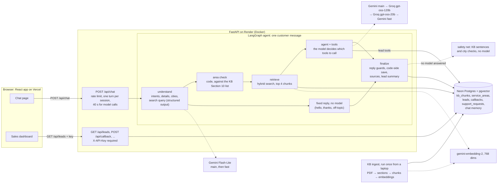

# Vantis Sales Agent

## Project Overview

An AI sales and lead-qualification assistant for **Vantis Energy Solutions**, a fictional rooftop-solar company. Customers chat with it on a web page. It answers from the Vantis knowledge base (KB) and shows which KB section each answer came from. When a customer sounds like a buyer, it collects their details one question at a time and checks them. It then scores the lead HOT, WARM or COLD, saves it, and gives the sales team a next step. A sales dashboard lists every lead with the reasons behind its score.

Built for the Pradrix AI Engineer Round 2 assignment.

| | |
|---|---|
| Chat page | <https://vantis-sales-agent.vercel.app> |
| Sales dashboard | <https://vantis-sales-agent.vercel.app/leads> (needs the sales key: [The sales key](#the-sales-key)) |
| API docs (OpenAPI) | <https://vantis-sales-agent-api.onrender.com/docs> |
| API health | <https://vantis-sales-agent-api.onrender.com/api/health> |
| Demo video | <https://drive.google.com/file/d/1My07Q9Dw26JAKZSTPgM41kEIMHxFgAWR/view?usp=sharing> |

> **The first request can be slow.** The API runs on Render's free plan. It sleeps after 15 idle minutes, and the first request after that took 32.5 s when measured. The page shows "Waking up the server. The first reply can take up to a minute." while it waits. During the review, a GitHub Actions job pings the API every 10 minutes from 08:00 to 23:00 IST to keep it awake.

**Contents:** [Try it](#try-it-in-3-steps) · [Problem](#problem-statement) · [Features](#features) · [Architecture](#architecture) · [How it works](#how-it-works) · [Database](#database-design) · [API](#api-documentation) · [Prompts](#prompt-engineering) · [Testing](#testing) · [Deployment](#deployment) · [Setup](#setup-instructions) · [Env vars](#environment-variables) · [Assumptions](#assumptions) · [Built vs future](#built-vs-future) · [Limitations](#limitations) · [Future improvements](#future-improvements)

## Try it in 3 steps

Open the [chat page](https://vantis-sales-agent.vercel.app) and type:

1. **`What solar systems do you offer for homes?`**
   The reply lists the reference packages for homes, with a source chip under it. Open **How I answered** under the reply to see each step and its time: understand, search, model call, any safety check.
2. **`I'm interested in a 5 kW system for my house in Lucknow. My bill is about ₹4,000 a month and I'd like it installed next month.`**
   A "Service area check: Lucknow: listed" step appears. The reply names the package that matches 5 kW and asks for your name and phone number.
3. **`Rahul Sharma, 9876543210, rahul.sharma@example.com`**
   The lead is saved, and the reply offers a callback. The **Sales view (demo)** card next to the chat shows it HOT with its score: 87 or 97 / 100, depending on whether the model read the message as "interested" or "ready to buy". In today's run it was 87.
   If you answer the offer with **`Yes, call me tomorrow evening.`**, the callback is logged as requested. A call request always counts as ready (a rule in code), so the lead goes to 97.

Then open [/leads](https://vantis-sales-agent.vercel.app/leads) and enter the sales key. Select the lead to see "Why this score" (each rule's points), the reason sentence and the next action. For a HOT lead that action is "Contact the lead within 1 hour and offer a site assessment."; once a callback is requested, it is "Call tomorrow evening, as requested, and offer a site assessment." Leads tagged "Demo" are sample data from `scripts/seed_demo_leads.py`, scored by the same rules.

More to try:
- A city that isn't listed ("Do you install in Pune?"): availability isn't confirmed, and the team can check.
- A price question: the reply explains how pricing works and never invents an amount.
- A 9-digit phone number: it is asked again, never saved.
- "My inverter has stopped working": a support request, not a sales lead.

## Problem Statement

Vantis gets messages from people thinking about rooftop solar. Most only want information; some are ready to buy. The sales team needs four things:
- the buyers spotted;
- their details collected without a long form;
- every lead qualified by the same rules;
- a clear next step for each one.

Every business fact must stay true to the company's knowledge base. Prices, warranty terms, subsidies and service areas must never be made up.

## Features

- **Grounded answers with sources.** Replies use only KB facts, and each cited KB section shows as a chip with its snippet. When the KB doesn't cover something, the reply says so.
- **Lead detection and gradual collection.** It asks one question at a time, never asks twice for a detail it has, and stops asking after two skipped questions.
- **Validation.** Indian mobile numbers, email syntax, rupee amounts ("4k", "1.2 lakh"), sizes and usage are checked. An invalid value is asked about again and never saved.
- **Deterministic lead scoring.** A score from 0 to 100 and a HOT / WARM / COLD status come from fixed rules in code. Each lead also stores its breakdown, a one-sentence reason and a recommended action.
- **Six tools the agent decides to call.** KB search, service-area check, create lead, update lead, callback request, support request.
- **Service-area checks** against the KB's city list. Renamed cities and small typos are handled, and a region is never treated as a city.
- **Support requests.** An existing customer's problem becomes a support request, not a sales lead.
- **Sales dashboard.** Status counts, filter, search and sort. The lead detail shows the score breakdown, caps, reason, next action, callbacks and contact details.
- **Every step visible.** "How I answered" under each reply shows what each step did, which model answered and how long it took.
- **Never crashes.** Failed models fall through a chain of four answer models. If none answers, a safety net builds the reply from the KB with no model.
- **Production basics.** Per-IP chat rate limits, a key-protected sales API, Docker, and a deployment on Render, Vercel and Neon.

## Architecture



The full module map, the request flow, retrieval and the frontend are in [docs/ARCHITECTURE.md](docs/ARCHITECTURE.md).

### Tech Stack

| Part | Choice | Why |
|---|---|---|
| Backend | Python 3.12, FastAPI 0.143, Pydantic 2.14, SQLAlchemy 2.1 + psycopg 3 | Typed request and response models, with OpenAPI docs generated from them |
| Agent | LangGraph 1.2 + langchain-core 1.6 | An explicit graph, so each step can be tested on its own. The Postgres checkpointer gives each chat its memory |
| LLMs | Gemini `gemini-3.5-flash-lite` (main) and `gemini-3.1-flash-lite` (fast), with Groq `openai/gpt-oss-120b` and `openai/gpt-oss-20b` as fallbacks | Free tiers with a separate quota per model. Groq is a second provider, so a slow Google minute doesn't stop the chat. Model names come only from env vars |
| Embeddings | `gemini-embedding-2`, 768 dimensions | The same Google key; 768 dimensions keep vectors small |
| Database | Neon Postgres + pgvector | One database for KB chunks (vector and full-text search), service areas, leads, callbacks, support requests and chat memory. 54 chunks need no vector index |
| Frontend | React 19, Vite 8, plain CSS, lucide-react icons | Small, with no UI framework |
| Hosting | Render (free Docker web service, Singapore), Vercel, Neon (AWS Singapore) | Free plans, with the API next to its database |
| Tests | pytest, Vitest + Testing Library | The LLM is always faked in unit and API tests |
| Tracing (optional) | LangSmith | Laptop only. Off on Render, so no chat text leaves the server |

## How it works

### The AI understands, the code enforces

The models read and write language. Code makes every decision that has to be right every time.

- **The model reads the message.** The understand step is an LLM with structured output. It turns each message into fields:
  - the intents, and the lead details the customer stated;
  - every city named, and any locality;
  - what the message does with the bot's last question (answers, skips, declines, goes ahead...);
  - whether a problem with an installed system is happening now;
  - a search query rewritten in the KB's own words.
- **Code decides.** From those fields, code decides:
  - which route the turn takes;
  - whether a city is listed (a lookup in the KB Section 10 table);
  - whether the lead has enough details to be saved;
  - the score, status and next action (pure functions);
  - when to stop asking questions;
  - which sentences may stay in the reply (the guards below).
- **The lead tools take no arguments.** They save the validated draft from the graph's state. The model chooses *when* to save a lead; it can't change *what* gets saved.
- **Word lists are only a backup.** The code's word lists (`app/agent/text_details.py`) run only when the understand step fails.

### Agent Workflow

A LangGraph `StateGraph` (`backend/app/agent/graph.py`) runs once per customer message:

1. **understand**: the main Gemini model, then the fast one, each with a 5 s deadline. It reads the new message, the last 6 messages and the bot's last reply (up to 1,500 characters). Code then checks every city named (the "area check"). It also adds KB rows the answer will need:
   - the catalog summary, for a stated size or a "what do you offer?" question;
   - the package-guidance rows, on a turn that gives the bill for a known kind of property.

   If both models fail, the raw message becomes the search query and code reads the details.
2. **Route.** Only a greeting gets the welcome text. Only thanks or bye gets the closing line. Off-topic with no KB question gets a polite redirect. None of these call a model. A message with only details, or a request to be contacted, goes straight to the agent with no search. Everything else goes to retrieve.
3. **retrieve**: hybrid search, top 4 chunks. When the search found only part of the package list, the rest is added.
4. **agent**: the main model with the six tools bound, for up to 4 tool rounds, then the final answer.
5. **finalize**:
   - saves a lead in code if everything required is known and the model didn't call `create_lead`;
   - runs the reply guards and picks the sources;
   - writes new details to a saved lead;
   - builds the lead summary for the sales card.

The state is checkpointed in Postgres per `session_id`: messages, lead draft, details the customer ruled out, and where the city came from. Per-turn fields reset each turn, and tool messages never enter the saved history. The agent sees the last 12 messages.

### RAG Implementation

- **Ingest** (`python -m app.rag.ingest`, run once from a laptop):
  - pdfplumber parses the KB PDF into its 19 numbered sections and their tables.
  - The chunker splits by structure: one chunk per table row (KB Sections 8-12), a summary chunk listing every row for Sections 8 and 10, one chunk per FAQ (Section 15), and prose split at about 1,200 characters.
  - Sections 16-19 are instructions for the assistant, not facts. They are tagged `policy` and never returned to answers.
  - The result is 54 chunks, 50 of them searchable. Each is embedded as `title: KB Section N: Title | text: …`.
  - Everything is embedded first, then all rows are replaced in one transaction. The KB Section 10 table also fills `service_areas`.
- **Search** (`app/rag/retriever.py`):
  - **Keyword:** Postgres full-text. Words found in more than 30% of chunks are dropped, because `ts_rank_cd` has no IDF.
  - **Vector:** cosine similarity in pgvector.
  - **Fusion:** Reciprocal Rank Fusion (k = 60, with the keyword list weighted 0.5), top 4 to the model.
  - **Relevance gate:** below a best similarity of 0.63 there is no context, and the reply says the information doesn't cover the question. Off-topic questions scored 0.49-0.58; KB questions 0.68-0.84.
  - **Fallback:** if embedding the query fails (3 s deadline), search runs keyword-only and the turn is marked degraded.
- **Query rewrite:** the understand step writes the search query in the KB's words, since it sees the KB section titles. "What solar systems do you provide?" became "Product & Service Catalog offerings and reference packages", and its first correct hit moved from 6th to 1st.
- **Citations:**
  - Every chunk enters the prompt labelled `[KB Section N: Title]`, and the reply cites with that label.
  - The page turns each label into a small "KB N" tag. The API returns `sources` (section, title, page, snippet) only for the sections the reply cites.
  - Code removes a tag that this turn's chunks don't support and a tool cited like a source. It adds the tag a reply left out when the reply used the chunks.

### Tools / Function Calling

The model gets six tools (`app/agent/tools.py`) and decides when to call them. Each tool returns content for the model plus an artifact for the graph (chunks, ids). Scores and statuses never reach the model.

| Tool | Arguments | What it does |
|---|---|---|
| `search_knowledge_base` | `query` | A further KB search when the given context doesn't answer |
| `check_service_area` | `city`, `state` | Listed or unverified, with the region and the KB Section 10 summary as the source. Code already checks every city the message names; this is for any other city |
| `create_lead` | none | Saves the validated draft and scores it. Refuses with the missing fields until the minimum is known. One lead per chat; refuses in a support conversation |
| `update_lead` | none | Saves details given after the lead was saved, and re-scores |
| `schedule_callback` | none | Logs the customer's time as a **requested** callback, which the team confirms; it is never "booked". A new time updates the same request |
| `create_support_request` | none | An existing customer's problem becomes a support request with an id, never a lead |

### Service-area checks

- **The list comes from the KB.** KB Section 10 is a table of regions and their cities. It is read from the `service_areas` table, never from code.
- **Every city named is checked in code** before the model answers. The check shows as a "Service area check" step with the KB Section 10 source chip.
- **Lookup** (`app/services/service_areas.py`) tries, in order:
  - an exact match;
  - the small alias map for renamed cities (Gurgaon → Gurugram, Allahabad → Prayagraj, New Delhi → Delhi), the one piece of business data written in code;
  - a fuzzy match (rapidfuzz, score 85 or more);
  - one swapped pair of letters, so "Dehli" is Delhi (but Raipur never becomes Jaipur).
- **The result is "listed" or "unverified".** The KB says unlisted places are unverified, so the reply says the place isn't on the current service list and the team can check. It never says "we don't serve it".
- **Regions and nearby places.** A region ("Delhi NCR", "UP") is never confirmed as a city: the reply names its listed cities and asks which one. A place only near a listed city, or a separate town such as Greater Noida, is unverified. Only a place inside a listed city is confirmed.

### Lead qualification

**When a lead is saved:** only with a name, a valid phone number or email, a city, and some need (a requirement, bill, usage, size, property type, or home vs business). Until then, the details stay in the chat and the bot asks for what is missing.

**Score** (`app/leads/scoring.py`, 100 points):

| Signal | Points |
|---|---|
| Intent | ready 25 · interested 15 · exploring 5 · unknown 0 (asking to be called counts as ready) |
| Requirement | clear (a size in kW, a monthly bill or monthly usage) 20 · described in words only 10 · none 0 |
| Location | listed city 20 · unverified 5 · unknown 0 |
| Timeline | within about a month 20 · 1-3 months 15 · 3-6 months 8 · over 6 months 3 · unknown 0 |
| Contact | valid phone and email 10 · one of them 6 |
| Property | owner with a usable rooftop 5 · partly known 2 · renting, no rooftop or unknown 0 |

- **Status:** HOT at 75 or more, WARM at 45-74, COLD below 45.
- **Caps:**
  - An unlisted city, or a need outside the reference packages, caps the lead at WARM and its score at 74. Such leads need checking first, so they can't be HOT.
  - A lead that is only exploring, with no timeline under 3 months, is capped at COLD and 44.
  - A cap is recorded only when it lowers the score. The breakdown keeps the score before the cap.
- **Recommended action:**
  - HOT: "Contact the lead within 1 hour and offer a site assessment."
  - WARM: "Follow up within 24 hours." plus what to verify or collect next.
  - COLD: add to the nurture list and follow up in 30 days.
  - A requested callback time replaces the status's own timing.
- **Reason:** one sentence, written by the fast model after the reply has gone out. It sees only the breakdown and the city, never a name, phone, email or amount. The code adds what keeps the lead from the next status ("…; not HOT yet: no timeline."). A template sentence is used when the model fails or breaks a rule.

The demo lead, from a live test. The reason's wording changes from run to run; the score, status and action don't.

```json
{
  "lead_score": 97,
  "lead_status": "HOT",
  "reason": "This lead is hot because the customer in Lucknow is ready to buy a 5 kW system and has provided their contact details.",
  "recommended_action": "Contact the lead within 1 hour and offer a site assessment."
}
```

The rules in full, with worked examples: [docs/SCORING.md](docs/SCORING.md).

### Guards on our own replies

Prompts alone slip, so `finalize` checks every model reply in code (`model_reply` in `app/agent/graph.py`, with helpers in `app/rag/` and `app/agent/`). Each guard that fires adds a "Safety check on the reply" step, so a slipping prompt is visible.

- **Citations:** a KB tag stays only on a fact from this turn's chunks, and the tag is added when the reply used the chunks without one.
- **Numbers:** no number, duration, amount, price or percentage that no source gave. Allowed sources are this turn's chunks and tool results, the customer's messages, earlier replies and validation messages. A fixed line says the team confirms exact numbers.
- **Uncovered topics:** on topics the KB doesn't cover (discounts, offers, brands) the reply states no policy either way. Nothing is called free unless the KB says so.
- **Packages:** until a size is settled, a reply names every reference package for the customer's kind of property, or none.
- **Claims and promises:**
  - no "your details are saved" before a lead exists;
  - a callback sentence says exactly what was logged;
  - "the team will call" becomes "the team can".
- **Plain words:** "service areas", never "the knowledge base". A KB rule written for the assistant is never quoted to the customer.
- **Regions:** a region is never confirmed as a city.
- **Questions:**
  - no repeat of the last question;
  - each kind of offer once per chat, and none after two skipped questions;
  - no request for contact details on a turn that only asked for information;
  - one question per reply.
- **Required lines:** "What do you offer?" always gets the KB Section 8 list. A stated size always gets "a site assessment confirms the final size".
- **No empty reply:** if nothing is left after the guards, a fixed line is sent instead.

### Fallback chain and safety net

| Step | Models, in order | Deadline per model | If all fail |
|---|---|---|---|
| understand | Gemini main → Gemini fast | 5 s | The raw message is the search query; code reads the details |
| answer | Gemini main → Groq `gpt-oss-120b` → Groq `gpt-oss-20b` → Gemini fast | 8 s, 10 s, 10 s, 8 s | One last try, then the safety net |
| lead reason (after the reply) | Gemini fast | 8 s | A template sentence |
| query embedding | `gemini-embedding-2` | 3 s | Keyword-only search |

- **Deadlines.** Each model gets one attempt, cut off by a wall-clock deadline. Gemini's API refuses HTTP timeouts under 10 s, so a thread-pool deadline cuts the call sooner.
- **Skip list** (`app/core/llm.py`):
  - A timeout or 5xx pauses that model for 15 s, for that kind of call only. If it fails again soon after the pause, the pause doubles, up to 60 s.
  - A 429 pauses the model for every kind of call, for the provider's retry-after or 60 s.
  - A paused model is passed over at once.
- **Turn budget and last try.** All of a turn's model calls must fit in 40 s. If every answer model failed and no tool wrote anything, there is one last try: wait up to 10 s for a paused model, or call the main model with a 20 s deadline.
- **Safety net** (`app/agent/fallback.py`), used when no model answered. The reply is built from:
  - the code's city checks;
  - one or two KB sentences from this turn's chunks that share a key word with the message;
  - what this turn saved;
  - one question.
  
  It needs no model and can't invent anything. The response's `answered_by` says who wrote the reply: `model`, `knowledge_base`, `tools` or `fixed`.
- **Database down:** `/api/chat` answers 503 with a friendly message, and never says a lead was saved when the write failed. Anything else is a 200 with a friendly reply. The chat never returns a 500.
- **Duplicates:**
  - Each session runs one turn at a time (64 striped locks, 60 s timeout).
  - A message sent again after a lost reply (same `client_message_id`) gets the reply already sent, not a second turn.

## Database Design

One Neon Postgres database (`app/rag/models.py`, `app/leads/models.py`). Tables are created at startup (`CREATE EXTENSION vector` + `create_all`).

| Table | Holds |
|---|---|
| `kb_chunks` | `chunk_id`, `section_no`, `section_title`, `page`, `chunk_type` (prose, table_row, table_summary, faq, policy), `content`, `metadata`, `embedding vector(768)`, `tsv` (generated, GIN index), `doc_version` |
| `service_areas` | `city`, `region`, `source`; unique on city + region |
| `leads` | Contact: `name`, `phone` (stored as +91…), `email`. Place: `city`, `city_input` (the customer's words), `state`, `location_status`. Property: `customer_type`, `property_type`, `ownership`, `rooftop_available`. Energy: `monthly_bill_inr`, `monthly_units_kwh`, `system_size_kw`, `requirement`. Intent: `timeline`, `timeline_bucket`, `intent_level`. Plus `lead_score`, `lead_status`, `score_breakdown` (JSONB), `reason`, `reason_source`, `recommended_action`, `source_channel`, `session_id` (unique), `created_at`, `updated_at` |
| `callbacks` | `lead_id` (foreign key, cascade), `preferred_time` (the customer's words), `notes`, `status` (requested), `created_at` |
| `support_requests` | `name`, `phone`, `email`, `project_details`, `issue`, `status` (open), `created_at`; never linked to a lead |
| `checkpoints`, `checkpoint_blobs`, `checkpoint_writes` | LangGraph's chat memory, one thread per `session_id` |

## API Documentation

Interactive docs: [/docs](https://vantis-sales-agent-api.onrender.com/docs). Its **Authorize** button takes the sales key.

| Method | Path | Access | What it does |
|---|---|---|---|
| POST | `/api/chat` | Public; 10 a minute and 100 a day per client IP | `{message (1-1,000 chars), session_id?, client_message_id?, channel?}` → `{session_id, reply, sources, steps, lead, degraded, answered_by}`. Leave `session_id` out on the first message; the server issues a UUID v4 |
| GET | `/api/welcome` | Public | The welcome text and starter questions (no model) |
| GET | `/api/health` | Public | `status`, `db`, `kb_chunks` (200 even when the database is down) |
| GET | `/api/health/live` | Public | The process is up; no database query. This is Render's health check |
| GET | `/api/leads` | Sales key | `status`, `q` (name or city), `sort` (newest or score), `limit`, `offset` → `items`, `total`, `counts` |
| GET | `/api/leads/{id}` | Sales key | Every field, plus `score_breakdown`, `reason`, `recommended_action`, callbacks |
| POST | `/api/leads` | Sales key | A manual lead, with the same validation and scoring as the chat |
| POST | `/api/callback` | Sales key | `{lead_id, preferred_time, notes}` → a requested callback (201; 200 when it updates the lead's request) |
| GET | `/api/support-requests` | Sales key | Support requests, newest first |

- **Sales key:** sent in the `X-API-Key` header and compared in constant time. If the server has no key, or one shorter than 16 characters, every sales request gets 503. After 10 wrong keys in 15 minutes from one IP, that IP gets 429.
- **Errors:** always JSON with `detail` and `request_id`. 422 lists field messages and never echoes the input. 429 adds `Retry-After`.
- **Never returned:** the sales API never returns `session_id`, which is the key to a customer's chat.
- **Score in the chat API:** `lead.status` and `lead.score` appear in `/api/chat` only when `CHAT_SHOW_LEAD_SCORE` is true (demo mode).

## Prompt Engineering

Every prompt is a Markdown file in [prompts/](prompts/), loaded by `load_prompt(name)`. No prompt text is written in code.

| Prompt | Used by | What it controls |
|---|---|---|
| `system_prompt.md` | The agent (system message) | Role and tone; facts only from the KB; the never-invent list (KB Section 16); citations; tool rules; one question per reply; how to word listed and unverified cities |
| `rag_prompt.md` | Wraps the customer's message | The labelled KB context, the lead-progress block (what is known and still needed, never a score), the service-area results, and a final checklist |
| `lead_extraction_prompt.md` | The understand step (structured output) | Intents, details by `LeadData` field, reply type, cities and locality, problem now, and the search query in the KB's words |
| `lead_qualification_prompt.md` | The lead reason | One sentence from the score breakdown only; code adds the "not HOT yet: …" ending |
| `package_guidance_prompt.md` | The agent, on a turn that gives the bill | A bill alone never picks one package: name all the reference packages for a home or a business, or ask which |

[prompts/README.md](prompts/README.md) explains each prompt and logs all 44 changes. Each row says what changed, why, and the example that failed before. Three of them:
- **Query rewrite.** v0 copied "What solar systems do you provide?" as the search query, so the catalog was missed. After the rule "rewrite in the KB's own words", the first hit moved from 6th to 1st.
- **A bill alone never picks a package.** The same bill message got HomeStart 3 locally and HomePro 5 on Render, because the KB gives no bill ranges.
- **No policy on uncovered topics.** "can I get 20% discount?" got "Vantis doesn't offer a specific discount rate", but the KB never mentions discounts. Now the reply says it can't confirm, and a guard backs the rule up.

`tests/test_prompt_examples.py` fails if a prompt's example is a near copy of an eval or live-test question, so the prompts can't be tuned to the tests.

## Testing

**Today's runs (2026-10-14):**
- Backend, `cd backend && python -m pytest -q`: **1247 passed**, with the 13 live tests deselected, in 5 min 35 s.
- Frontend, `cd frontend && npm test`: **260 passed** (11 files).
- The 4-turn demo with real models, `python -m pytest -m live tests/test_live_lead_flow.py -k demo_script`: **passed** in 85 s with 12 model calls.
  - Turn 1 listed the 3 home packages with a KB Section 8 tag.
  - Turn 2 checked Lucknow as listed, named HomePro 5 with the site-assessment line, and asked for name and phone.
  - Turn 3 saved the lead at HOT 87.
  - Turn 4 logged the callback as requested and raised the lead to HOT 97. Its action: "Call tomorrow evening, as requested, and offer a site assessment."
  - The fast model answered the first lead reason. On the refresh after turn 4 it returned a 503, so the template sentence was used.

**What the unit and API tests cover:**
- The LLM is always faked. DB tests run on a separate Neon test branch and skip without `TEST_DATABASE_URL`.
- Backend: validators, scoring and caps, the service-area lookup, chunking, retrieval, every graph route and guard, and the fallback chain on a fake clock (including replays of slow-Google minutes from Render's logs). Also the API (auth, rate limits, error shapes) and the deploy config.
- Frontend: the chat page, the dashboard, routing, and the contrast of every colour pair in light and dark (WCAG AA).

**Retrieval eval** (`python -m scripts.eval_retrieval`; measured on 12 Oct, T12b; full report in [docs/EVAL.md](docs/EVAL.md)):

| 24 KB questions (top 10 per search) | hit@1 | hit@3 | MRR |
|---|---|---|---|
| keyword only | 18/24 | 20/24 | 0.802 |
| vector only | 19/24 | 22/24 | 0.867 |
| hybrid | 21/24 | 22/24 | 0.907 |
| hybrid on the understand step's rewritten query (what the agent uses) | 23/24 | 23/24 | 0.969 |

- **Relevance gate:** blocks 8 of 8 off-topic questions and wrongly blocks 0 of 24 KB questions.
- **Held-out questions:** with the rewrite, 6 of 7 have their best section in the top 3, and 7 of 7 have a listed section.
- **Not re-run:** the understand prompt has changed since 12 Oct, and the eval wasn't run again.

**Live tests and scenarios** (real models; every lead write goes to the test branch, never main):
- `python -m pytest -m live`: 13 tests, including the 4-turn demo that must end HOT with a requested callback.
- `python -m scripts.live_scenarios --group …` runs real chats against a local test server and prints PASS or FAIL for each check. Every reply's numbers are checked against the whole KB.
- The groups: `holdout`, `edge` (missing, invalid and unknown information, an existing customer, off-topic then back), `slow` (every Gemini call hangs, so Groq and the deadlines answer), `replay`, `t13d`, `t13e`, `t13e-fix`.

**Held-out testing.** Test packs and personas were written apart from the code, with new wording each round, so fixes couldn't be tuned to the test text:
- **Held-out questions:** another model (DeepSeek) wrote 8 questions without seeing the KB. They were labelled by hand before any search and never used for tuning.
- **Break-it chats:** Adithya's break-it chats on the live site (13 and 14 Oct) became scenario groups. The checks that failed in `t13e` were rerun with two new phrasings each (`t13e-fix`).

| Run (date) | Result |
|---|---|
| Held-out chat, 8 sessions (12 Oct) | 8/8 after a prompt fix; two replies had invented a staff and a policy |
| Edge cases, 11 turns (12 Oct) | 11/11 after three fixes to the script's own checks (re-checked on the recorded replies) |
| Slow-Google drill on Groq (12 Oct) | 3/3 with the lead saved, on the second run |
| Break-it replay C8, 7 turns (13 Oct) | 7/7 turns pass every check |
| t13d (14 Oct) | 9/12; after code fixes, D6 and D7 passed when re-run |
| t13e → t13e-fix → round 3 (14 Oct) | 11/14 → 9/11 → 4/5; the one still failing is F11 (see [Limitations](#limitations)) |

## Deployment

- **Backend on Render:**
  - A free Docker web service in Singapore, from `render.yaml` and the `Dockerfile` (python:3.12-slim, non-root user, one uvicorn worker).
  - Render's health check is `/api/health/live`, which doesn't touch the database.
  - A push to `main` redeploys, but only when the image's files change (`buildFilter`).
- **Frontend on Vercel:** the root directory is `frontend`, and `VITE_API_URL` is the Render URL. `frontend/vercel.json` sends every path to `index.html`, so deep links like `/leads/12` work.
- **Database on Neon** (AWS Singapore): the `main` branch holds the live data and a `test` branch holds the tests' data. The KB was ingested once from a laptop, so the server never needs the PDF.
- **CORS** allows only the Vercel URL.
- **Demo mode is on for the review.** `CHAT_SHOW_LEAD_SCORE=true`, and the "Sales view (demo)" card sits next to the chat, so reviewers can see what sales gets from each chat. A real launch would turn both off, because the chat is customer-facing.
- **Keep-warm:** [.github/workflows/keep-warm.yml](.github/workflows/keep-warm.yml) calls `/api/health/live` every 10 minutes from 08:00 to 23:00 IST. To switch it off after the review: GitHub → Actions → "Keep the API warm" → Disable workflow (or `gh workflow disable keep-warm.yml`).
- **Tracing** (LangSmith) is off on Render.

Step-by-step setup and checks: [docs/DEPLOY.md](docs/DEPLOY.md).

## Setup Instructions

You need:
- Python 3.12;
- Node.js 22.22+ or 24.15+;
- a Postgres database with pgvector (Neon's free plan works; use the direct, non-pooled connection string);
- a Gemini API key (Google AI Studio);
- a Groq API key.

Commands below are for Git Bash on Windows; on macOS or Linux, activate with `source .venv/bin/activate`.

```bash
# 1. Backend
cd backend
python -m venv .venv
source .venv/Scripts/activate
pip install -r requirements.txt
cp .env.example .env        # then fill in DATABASE_URL, GOOGLE_API_KEY, GROQ_API_KEY and SALES_API_KEY

# 2. The knowledge base. The KB PDF is assessment material, so it is not in this repo.
#    Put your copy at data/kb/Vantis_Energy_Solutions_Knowledge_Base.pdf (repo root), then:
python -m app.rag.ingest --dry-run   # parse and print the chunks; no database or key needed
python -m app.rag.ingest             # embed and write kb_chunks and service_areas

# 3. Run the API (tables are created at startup)
uvicorn app.main:app --reload --port 8000   # docs at http://127.0.0.1:8000/docs

# 4. Frontend, in a second terminal
cd frontend
npm install
npm run dev                          # http://localhost:5173; the dashboard is at /leads

# Tests, from the repo root
cd backend && python -m pytest -q    # the LLM is faked; DB tests need TEST_DATABASE_URL
cd frontend && npm test
```

For the local dashboard, use the `SALES_API_KEY` from your `backend/.env`. Make one with `python -c "import secrets; print(secrets.token_urlsafe(32))"`. More commands (retrieval eval, live scenarios, demo data, Docker) are listed in [CLAUDE.md](CLAUDE.md#commands-windows--git-bash).

## Environment Variables

Names only; `backend/.env.example` and `frontend/.env.example` hold the defaults and notes.

| Variable | What it is for |
|---|---|
| `DATABASE_URL` | Neon direct (non-pooled) connection string |
| `TEST_DATABASE_URL` | Optional. A separate Neon branch for tests; DB tests skip without it |
| `GOOGLE_API_KEY` | Gemini (chat models and embeddings) |
| `LLM_MODEL_MAIN`, `LLM_MODEL_FAST` | Gemini model names |
| `GEMINI_SERVICE_TIER` | `standard` (the default sends nothing) |
| `EMBEDDING_MODEL`, `EMBEDDING_DIM` | The embedding model; the dimension must match the vector column |
| `RETRIEVAL_MIN_SIMILARITY` | The relevance gate (0.63) |
| `GROQ_API_KEY`, `FALLBACK_MODEL`, `FALLBACK_MODEL_2` | The Groq fallback models |
| `SALES_API_KEY` | Sales API and dashboard; at least 16 characters |
| `CORS_ORIGINS` | Allowed frontend origins, comma-separated |
| `CLIENT_IP_HEADER` | The header with the real client IP (`CF-Connecting-IP` on Render; empty locally) |
| `CHAT_LIMIT_PER_MINUTE`, `CHAT_LIMIT_PER_DAY` | Chat messages per client IP |
| `KB_PATH` | Where ingest finds the KB PDF |
| `LOG_LEVEL` | Log level |
| `LANGSMITH_TRACING`, `LANGSMITH_API_KEY`, `LANGSMITH_PROJECT`, `LANGSMITH_HIDE_INPUTS`, `LANGSMITH_HIDE_OUTPUTS`, `LANGSMITH_HIDE_METADATA` | Optional LangSmith tracing |
| `CHAT_SHOW_LEAD_SCORE` | Status and score in the chat's lead card (demo only) |
| `VITE_API_URL` (frontend) | Where the API runs; default `http://127.0.0.1:8000` |

### The sales key

The dashboard and the sales endpoints need the sales API key. It is **not** in this repository or the demo video; it was sent with the submission. The dashboard keeps it in the browser tab's session storage only. The key will be rotated after the review.

## Assumptions

1. A lead is saved only with a name, a valid phone or email, a city and some need. Until then, the details stay in the conversation.
2. An unlisted city, or a need outside the reference packages, means "check first", not "no". Such a lead is capped at WARM and flagged for verification, because KB Section 10 calls unlisted places unverified.
3. Callbacks are requests for the team to confirm, not booked appointments.
4. Package names are reference options until a site assessment.
5. Money is in INR, and phone numbers are Indian mobiles.
6. The KB is the only source of business facts. The renamed-city aliases are general knowledge.
7. The chat is in English; Hindi and Hinglish messages work on a best-effort basis.
8. Sales access is one shared key. That is demo-grade, with no per-user accounts or roles.
9. The KB PDF is assessment material, so it isn't committed. The live demo reads the KB from the database.
10. Demo mode stays on for the review (the score on the chat's sales card).

## Built vs future

**Built:**
- the chat with RAG and source citations;
- the LangGraph agent with six tools;
- lead detection, validation, scoring and storage;
- callback requests and support requests;
- the sales dashboard;
- the API with key auth and rate limits;
- Docker, and the deployment on Render, Vercel and Neon;
- the retrieval eval and the live scenario scripts;
- optional LangSmith tracing, and the keep-warm job.

**Not built:**
- **A mock WhatsApp interface.** It was optional; the leads table already accepts a `whatsapp` channel.
- **Streaming replies.**
- **A CI pipeline.** The only GitHub Action is the keep-warm ping.
- Everything under [Future improvements](#future-improvements).

## Limitations

- **Free-tier quotas.** As recorded in `backend/.env.example`:
  - Gemini Flash-Lite allows 15 requests a minute and 500 a day per model.
  - Groq allows 30 a minute, 1,000 a day and 8K tokens a minute per model.
  - Embeddings allow 100 a minute and 1,000 a day.
  - A turn uses about two or three Gemini calls, so the whole service handles a few turns a minute.
- **When Google is overloaded:**
  - Turns fall through to Groq and the fast model. Groq's 8K tokens a minute carry about one turn a minute.
  - If nothing answers within the turn's 40 s, the safety net replies from the KB with no model. It is correct, but plainer.
  - Fallback models write weaker replies. The guards catch invented numbers, partial package lists, policies and "free" claims, but not every invented phrase.
- **Cold start.** Render's free service sleeps after 15 idle minutes; the first request took 32.5 s when measured. The keep-warm job covers 08:00-23:00 IST, but GitHub can start a scheduled run a few minutes late.
- **An unlisted city is WARM at most.** A strong buyer in an unlisted city can't be HOT until the team verifies the area. That is by design, following KB Section 10.
- **The locality is not stored.** The understand step reads a locality (a sector or neighbourhood) and uses it for the city check, but the lead keeps only the city.
- **Known gap (F11).** "I have a question about my inverter" still opens the support flow (it asks for the customer's name) instead of answering first. A prompt rule and a code rule were both tried.
- **A follow-up can drop the "near".** When a customer says they live near a listed city, a later question that names no place can make the bot treat them as living in that city itself.
- **A locality can get two answers.** When a customer gives a locality and its city, one reply can say both that we cover the city and that we can't confirm the locality.
- **A customer's own timeline can get a "no information" reply.** When a customer says when they want the installation, the bot may answer that it has no information on installation timelines.
- **Invented package names.** The bot once named packages that aren't in the catalog (a "Compact Residential Package"). The package guard only checks the names in the KB, so it doesn't catch a new one.
- **The guards are English patterns.** They catch the phrasings seen in tests and live runs, not every paraphrase.
- **100 chat messages a day per IP** (and 10 a minute). People on one network, like an office or a college, share that limit. The count starts at the network's first message and resets 24 hours later, or sooner if the service restarts, redeploys or sleeps.
- **One server instance.** Rate limits, the skip list, session locks and the replay cache live in memory, which is right for one free instance, not for several.
- **No retention cleanup.** Conversations, including personal details, stay in Neon with no cleanup yet.
- **The relevance gate passes on-topic questions the KB doesn't answer** (for example, cleaning a water tank). The prompt and guards make the reply say so.
- **Pinned library internals.** `GeminiChat` relies on a private method of langchain-google-genai 4.4.1, so the version is pinned and tested.

## Future Improvements

- A WhatsApp channel, through a webhook adapter on the same agent;
- streaming replies;
- CI on GitHub Actions (tests, build and image) with Render deploying only after checks pass;
- Alembic migrations;
- per-user sales accounts and roles, and CRM sync;
- a retention period for chats;
- a shared rate-limit store (Redis) for more than one instance;
- a reranker, and LLM-judged answer evals;
- a hand-off to a human;
- fixing F11, and storing the locality on the lead.

## Repository map

```
backend/app/        FastAPI app: api/ (routes), agent/ (graph, tools, guards), rag/ (ingest, search, citations),
                    leads/ (validation, scoring, storage), services/ (service areas), core/ (config, DB, LLMs)
backend/tests/      pytest (unit, API, DB on the test branch; live tests marked "live")
backend/scripts/    eval_retrieval, live_scenarios, seed_demo_leads, serve_test_branch, search_kb, list_models
frontend/           React app: chat page, sales dashboard (/leads, /support)
prompts/            every LLM prompt, plus README.md with the change log
data/eval/          retrieval and held-out questions with their labels (the KB PDF goes in data/kb/, not committed)
docs/               ARCHITECTURE (module map), SCORING, EVAL, DEPLOY, PLAN (design record), PROGRESS (task log), CREDITS
```

Third-party photo, font and icons: [docs/CREDITS.md](docs/CREDITS.md).
