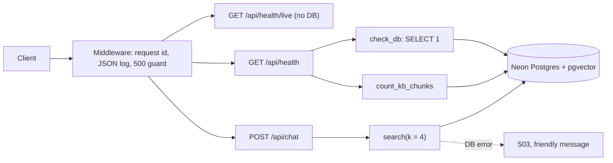
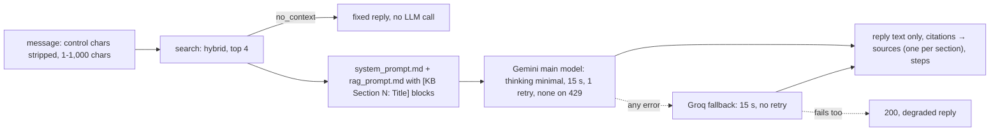
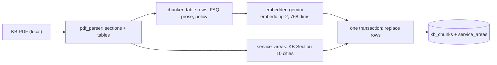
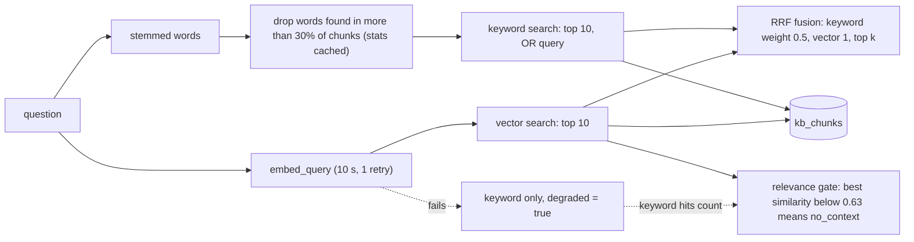
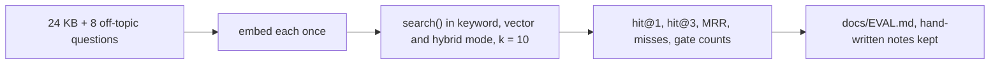

# ARCHITECTURE.md

Short map of how the code is built. Updated at the end of each task. See `docs/PLAN.md` for the full design.

## Backend modules (as of T6)
| Module | Role |
|---|---|
| `app/main.py` | FastAPI app, startup hook (`init_db`), request-id + logging middleware (skips `QUIET_PATHS`: `/api/health/live`), CORS, routers |
| `app/core/config.py` | `Settings` (pydantic-settings, reads `backend/.env`), `get_settings()` |
| `app/core/logging.py` | JSON log formatter, `request_id_var` |
| `app/core/db.py` | `Base`, `get_engine()` (Neon, pre-ping), `check_db()`, `init_db(engine)` (pgvector + `create_all`) |
| `app/core/llm.py` | `embedder()`: google-genai, one Content per text, batches of 20, vector count and size checks, document vs query timeouts, LRU cache for queries. `query_embedder()`: the same, or None (request dependency). `main_llm()` / `fast_llm()`: `chat_llm(model)` = Gemini (`thinking_level` minimal, 15 s, 1 retry, none on 429) `.with_fallbacks([Groq])` (15 s, no retry, `reasoning_effort` low); never raises when built. `invoke_llm()` → `LLMReply(text, provider, latency_ms)`, logs provider and latency; `reply_text()` keeps text blocks only and strips `<think>` |
| `app/core/prompts.py` | `load_prompt(name)`: reads `prompts/<name>.md` (cached) |
| `app/api/health.py` | `GET /api/health` (status, db, kb_chunks); `GET /api/health/live` (`{"status":"ok"}`, no DB, Render's health check) |
| `app/api/chat.py` | `POST /api/chat` v0: validates the message (control characters stripped, 1-1,000 chars), `search(k=4)`, `answer()`. DB down → 503; any other error → 200 degraded; `lead` always null |
| `app/rag/answer.py` | `answer(question, SearchResult, llm)`: no context → fixed reply without an LLM call; else system + RAG prompt → `invoke_llm`; LLM failure → degraded reply. `format_context` (`[KB Section N: Title]` labels), `cited_sections`, `pick_sources` (one per cited section), steps |
| `app/rag/pdf_parser.py` | `parse_kb(path)`: KB PDF to numbered sections with text lines and tables (pdfplumber; cover, header and footer removed) |
| `app/rag/chunker.py` | `Chunk`, `chunk_sections()`: one chunk per table row (KB Sections 8-12) plus one `table_summary` chunk listing every row (8, 10), one per FAQ item (15), prose split at ~1,200 chars, Sections 16-19 tagged `policy`; `embed_text()` = `title: ... \| text: ...` |
| `app/rag/models.py` | `KbChunk` (`kb_chunks`: vector + generated tsvector with GIN index) and `ServiceArea` (`service_areas`, unique on city + region) |
| `app/rag/ingest.py` | `python -m app.rag.ingest`: parse, chunk, embed all first, then replace all rows in ONE transaction; `--dry-run` prints chunks and touches no DB or key |
| `app/rag/retriever.py` | `search(query, k, mode)`: keyword (stemmed words OR'd, words in more than 30% of chunks dropped, `ts_rank_cd`) + vector (cosine), RRF fusion (k = 60, keyword weight 0.5), relevance gate (similarity only when a vector search ran), keyword fallback with `degraded`; policy chunks never returned |
| `app/services/service_areas.py` | `ServiceAreas.lookup(city, state)`: alias map + rapidfuzz (score 85); loads from the `service_areas` table (`get_service_areas()`, cached) |
| `scripts/list_models.py` | Lists Gemini chat and embedding models for the key |
| `scripts/search_kb.py` | Prints the mode, `no_context` and the top chunks with scores and ranks |
| `scripts/eval_retrieval.py` | Embeds the 24 KB and 8 off-topic questions once, runs `search()` in all three modes (k = 10), prints hit@1, hit@3, MRR, the misses and the gate results, and writes `docs/EVAL.md` (its "Tuning notes" section is hand-written and kept) |

Deployment files (repo root): `Dockerfile` (python:3.12-slim, app + prompts only, non-root, uvicorn on `$PORT`), `.dockerignore`, `render.yaml` (one free web service, Singapore). Steps: `docs/DEPLOY.md`.

## Request flow

## Chat v0 (T5)

## Ingestion (T3)

## Retrieval (T3, tuned in T4)

## Retrieval eval (T4)

