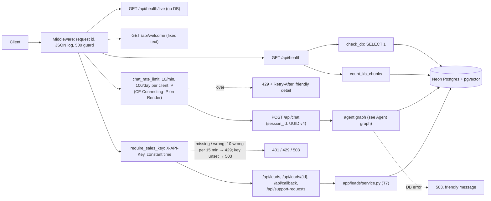
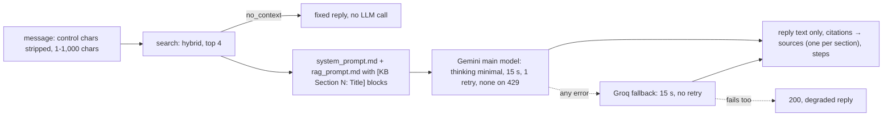
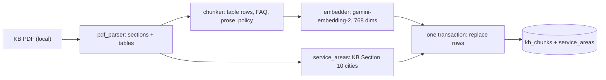
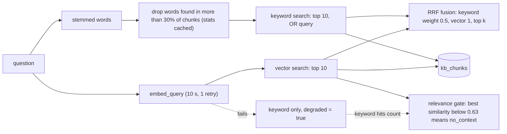
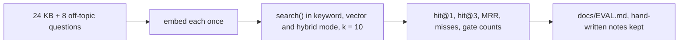
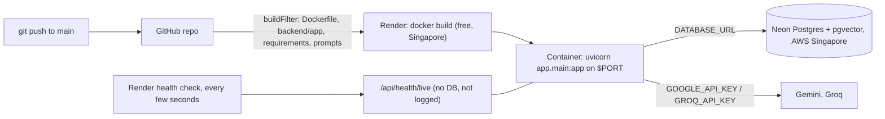
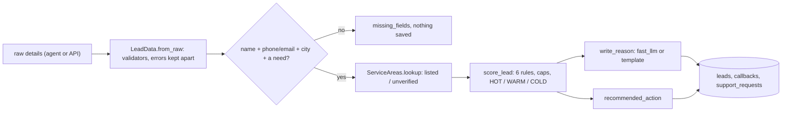
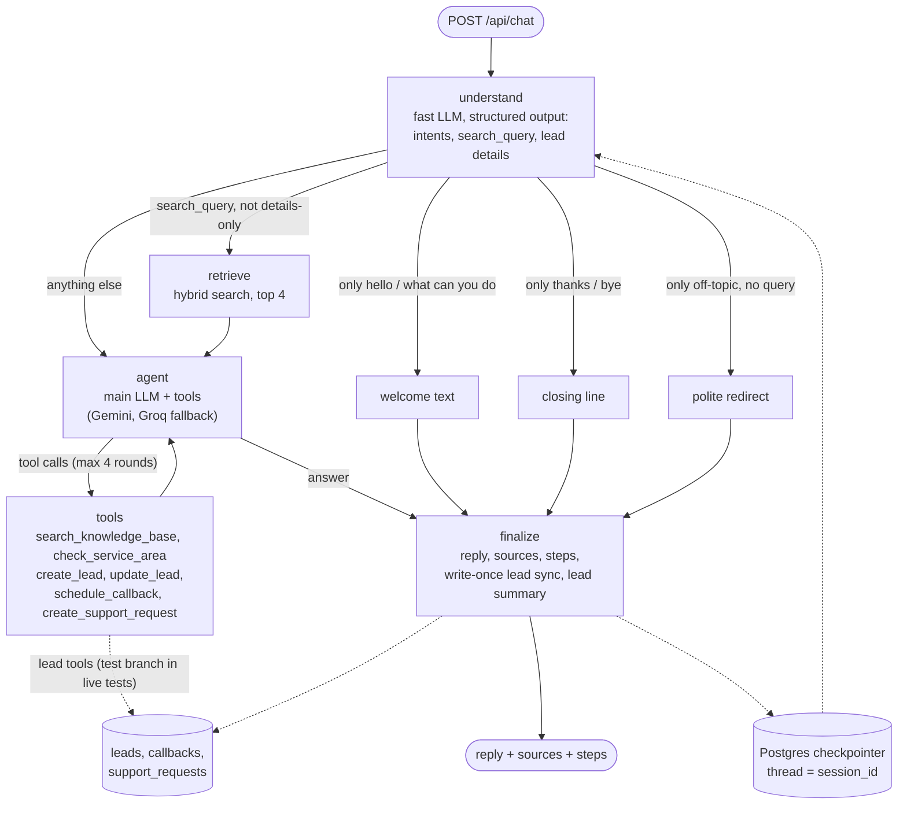
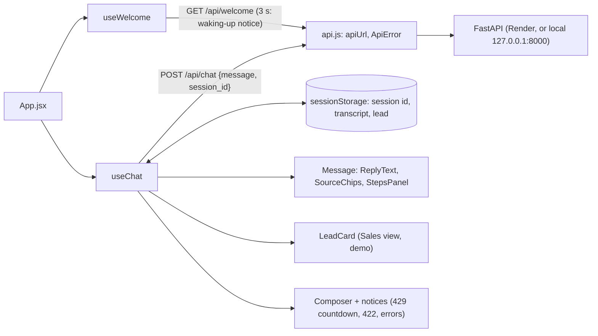

# ARCHITECTURE.md

Short map of how the code is built. Updated at the end of each task. See `docs/PLAN.md` for the full design.

## Backend modules (as of T10)
| Module | Role |
|---|---|
| `app/main.py` | FastAPI app, startup hook (`init_db`), request-id + logging middleware (skips `QUIET_PATHS`: `/api/health/live`; adds `ip_source` for rate-limited requests, never the IP), error handlers (`ApiError`, 422 with one message per field, database down → 503), CORS (GET/POST; `Content-Type`, `X-API-Key`, `X-Request-ID`; exposes `Retry-After`), routers |
| `app/core/config.py` | `Settings` (pydantic-settings, reads `backend/.env`), `get_settings()` |
| `app/core/rate_limit.py` | `RateLimiter(limits)`: in-memory fixed windows per key, thread-safe; `hit()` counts or returns the seconds to wait (a refused request is not counted), `blocked()` only checks |
| `app/api/security.py` | `client_ip` (the `CLIENT_IP_HEADER` value if it is one valid IP, else the connection address; never `X-Forwarded-For`), `limit_key` (IPv6 per /64), `chat_rate_limit` (10/min + 100/day per IP → 429 + Retry-After), `require_sales_key` (`X-API-Key`, constant-time, fails closed, 10 wrong keys per 15 min per IP → 429), `ApiError` + `error_response` (the JSON error shape) |
| `app/api/sales.py` | Sales router (key required): `GET /api/leads`, `GET /api/leads/{id}`, `POST /api/leads`, `POST /api/callback`, `GET /api/support-requests`, all through `app/leads/service.py`; never returns `session_id` |
| `app/core/logging.py` | JSON log formatter, `request_id_var` |
| `app/core/db.py` | `Base`, `get_engine()` (Neon, pre-ping), `check_db()`, `init_db(engine)` (pgvector + `create_all`) |
| `app/core/llm.py` | `embedder()` and `query_embedder()` (google-genai, one Content per text, batches of 20, LRU cache for queries). `GeminiChat`: adds our `http_options` (15 s, 1 retry, none on 429) to every Gemini request. `chat_llm(model, tools=, schema=)`: Gemini with a Groq fallback, built separately for plain, tool-bound and structured-output use (Groq: `parallel_tool_calls=False`). `main_llm()`, `fast_llm()`, `invoke_llm()`, `provider_of()`, `reply_text()` |
| `app/core/prompts.py` | `load_prompt(name)`: reads `prompts/<name>.md` (cached) |
| `app/agent/state.py` | `AgentState` (persisted `messages` and `lead`; per-turn fields) and `turn_input()`, which resets the per-turn fields |
| `app/agent/understand.py` | `Understanding` schema (intents, `search_query`, details generated from `LeadData`), `load_kb_hints` (section titles + table summary chunks from `kb_chunks`), `understand()` |
| `app/agent/tools.py` | `make_tools`: `search_knowledge_base`, `check_service_area` (content + KB chunk artifacts) and, with `LeadOps`, `create_lead`, `update_lead`, `schedule_callback`, `create_support_request` (no arguments; read the draft via `InjectedState`; no score in results); `tool_step` |
| `app/agent/graph.py` | `build_graph(AgentDeps)`: understand → retrieve → agent ⇄ tools → finalize, plus welcome / closing / redirect; `build_agent()`, `get_agent()` (FastAPI dependency) |
| `app/agent/leads.py` | `LeadOps` (leads database, reason model, `reason_now`), the lead progress block (`status_block`), `confirmed_city`, `pending_changes` (write-once sync), `lead_summary` for the API |
| `app/core/tracing.py` | `configure_tracing`: optional LangSmith; copies LANGSMITH_* settings into os.environ only when tracing is on and a key is set |
| `app/agent/memory.py` | `get_checkpointer()` (PostgresSaver over a psycopg pool), `setup_checkpointer()` (never fails the boot) |
| `app/agent/welcome.py` | Fixed texts: welcome (F0), starter questions, closing line, off-topic redirect |
| `app/api/welcome.py` | `GET /api/welcome` |
| `app/api/health.py` | `GET /api/health` (status, db, kb_chunks); `GET /api/health/live` (`{"status":"ok"}`, no DB, Render's health check) |
| `app/api/chat.py` | `POST /api/chat`: rate limited (`chat_rate_limit`); `session_id` must be a UUID v4 (the server issues one when none is sent); validates the message, runs the agent with `thread_id` = `session_id`, returns reply, sources, steps, `lead` (summary; status and score only with `CHAT_SHOW_LEAD_SCORE`) and degraded. One turn per session (striped locks, 60 s timeout); a pending lead reason is written after the reply (background task). DB errors → 503; anything else → 200 degraded |
| `app/rag/answer.py` | Helpers the agent reuses: `format_context` (`[KB Section N: Title]` labels), `rag_message`, `cited_sections`, `pick_sources` (one per cited section), `normalize_citations`, `retrieve_step`, `LLM_DOWN_REPLY` |
| `app/rag/pdf_parser.py` | `parse_kb(path)`: KB PDF to numbered sections with text lines and tables (pdfplumber; cover, header and footer removed) |
| `app/rag/chunker.py` | `Chunk`, `chunk_sections()`: one chunk per table row (KB Sections 8-12) plus one `table_summary` chunk listing every row (8, 10), one per FAQ item (15), prose split at ~1,200 chars, Sections 16-19 tagged `policy`; `embed_text()` = `title: ... \| text: ...` |
| `app/rag/models.py` | `KbChunk` (`kb_chunks`: vector + generated tsvector with GIN index) and `ServiceArea` (`service_areas`, unique on city + region) |
| `app/rag/ingest.py` | `python -m app.rag.ingest`: parse, chunk, embed all first, then replace all rows in ONE transaction; `--dry-run` prints chunks and touches no DB or key |
| `app/rag/retriever.py` | `search(query, k, mode)`: keyword (stemmed words OR'd, words in more than 30% of chunks dropped, `ts_rank_cd`) + vector (cosine), RRF fusion (k = 60, keyword weight 0.5), relevance gate (similarity only when a vector search ran), keyword fallback with `degraded`; policy chunks never returned |
| `app/leads/schemas.py` | `LeadData` (the lead contract: every field optional, null = unknown, units in names, per-field `description` for T8's structured output, `from_raw` keeps valid values and reports invalid ones), `LeadView` and the result models |
| `app/leads/validators.py` | Pure validators: Indian mobile → `+91XXXXXXXXXX`, email syntax (email-validator, no network), ₹ amounts (`₹4,000`, `4k`, `1.2 lakh`), kW, kWh, names, text; plain error messages |
| `app/leads/scoring.py` | `score_lead` (rubric, caps at WARM and 74, breakdown JSON), `status_for`, `recommended_action`, `missing_for_creation` |
| `app/leads/reason.py` | `write_reason`: one sentence from `fast_llm` (breakdown only, no personal details or money), template fallback |
| `app/leads/models.py` | `Lead` (`leads`), `Callback` (`callbacks`, status `requested`), `SupportRequest` (`support_requests`) |
| `app/leads/service.py` | `create_lead` (refuses until the minimum fields, one lead per session), `update_lead` (merge, re-locate, re-score), `get_lead`, `list_leads`, `schedule_callback`, `create_support_request`, `list_support_requests`; logs ids, status and score only |
| `app/services/service_areas.py` | `ServiceAreas.lookup(city, state)`: alias map + rapidfuzz (score 85); loads from the `service_areas` table (`get_service_areas()`, cached) |
| `scripts/list_models.py` | Lists Gemini chat and embedding models for the key |
| `scripts/search_kb.py` | Prints the mode, `no_context` and the top chunks with scores and ranks |
| `scripts/serve_test_branch.py` | Dev only: runs the API on 127.0.0.1:8000 with the chat agent's lead writes and the sales API (`leads_engine`) on `TEST_DATABASE_URL`; KB and service areas read from main; chat memory in the process (`InMemorySaver`). `engine_for_test_branch` refuses an empty or same-as-main URL |
| `scripts/eval_retrieval.py` | Embeds the 24 KB and 8 off-topic questions once, runs `search()` in all three modes (k = 10), prints hit@1, hit@3, MRR, the misses and the gate results, and writes `docs/EVAL.md` (its "Tuning notes" section is hand-written and kept). `--rewrite` adds the understand step's rewritten query (`rewrite` and `fused` modes) and the small-to-big report |

## Request flow

## Chat v0 (T5)

## Ingestion (T3)

## Retrieval (T3, tuned in T4)

## Retrieval eval (T4)

## Deployment (T6)
Files at the repo root: `Dockerfile` (python:3.12-slim, only the app package and `prompts/`, non-root user, one uvicorn worker on `$PORT`), `.dockerignore`, `render.yaml` (one free web service, region Singapore, next to Neon). Steps and limits: `docs/DEPLOY.md`.

## Leads layer (T7)
Called by T8's tools and T9's sales API (`app/api/sales.py`). Rules in plain words: `docs/SCORING.md`.

## Agent graph (T8a)
One customer message; state checkpointed in Postgres per `session_id`. Details: PLAN.md part 3.1.

## Chat page (T10, `frontend/`)
React 19 + Vite 8, plain JavaScript and CSS. Behaviour: PLAN.md part 3.14.

| Module | Role |
|---|---|
| `src/api.js` | `apiUrl(path)` (VITE_API_URL, trailing slashes removed, default `http://127.0.0.1:8000`), `getWelcome()`, `postChat({message, sessionId})`, `ApiError` (`rate_limit` / `invalid` / `server` / `network`), `errorFrom` (429 → `detail` + `retry_after` or the `Retry-After` header; 422 → first field message; else a generic message); 90 s timeout |
| `src/storage.js` | `loadChat` / `saveChat` / `clearChat`: session id, transcript and lead in sessionStorage; never throws |
| `src/useChat.js` | The conversation hook: messages, lead, session id, draft, `pending` / `slow` (8 s), `notice`, `waitLeft` (429 countdown), `send(text)` (one at a time; on failure the text goes back into the draft), `newChat()` |
| `src/useWelcome.js` | `GET /api/welcome` once; `slow` after 3 s (the waking-up notice), `retry()` after an error |
| `src/App.jsx` | Layout (header, transcript, notices, composer, sales panel or phone strip at 900 px), welcome + starters, typing indicator, screen-reader announcer |
| `src/components/ReplyText.jsx` | Reply text as React text nodes: paragraphs, lists, bold, `[KB Section N: Title]` → "KB Section N" tag |
| `src/components/SourceChips.jsx`, `StepsPanel.jsx`, `Message.jsx` | Source chips (`
`: section + title, snippet on open); "How I answered" (`
`: step label, detail, time); one message |
| `src/components/LeadCard.jsx` | "Sales view (demo)": saved or not, still needed / would add points, callback; status and score only when sent |
| `src/components/Composer.jsx` | Textarea (Enter sends, Shift+Enter new line, 1,000 characters), Send / "Wait N s" |
| `src/*.test.js(x)` | Vitest + Testing Library, `fetch` stubbed (`src/test-utils.js`) |

