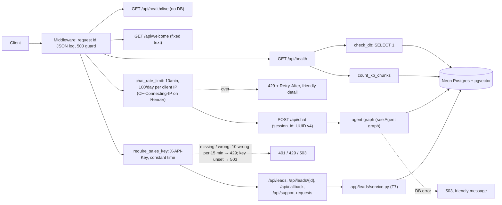
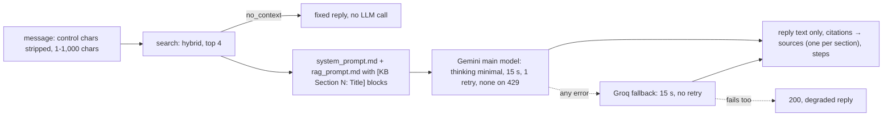
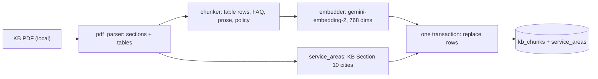
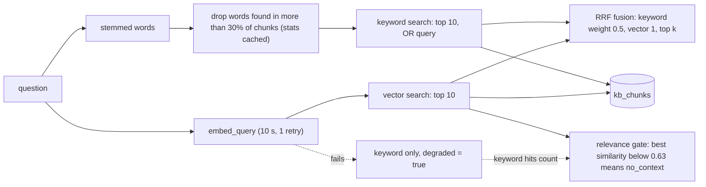
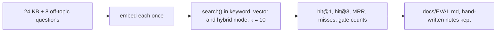
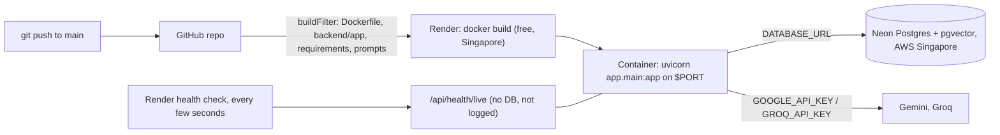
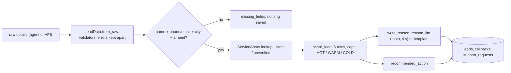
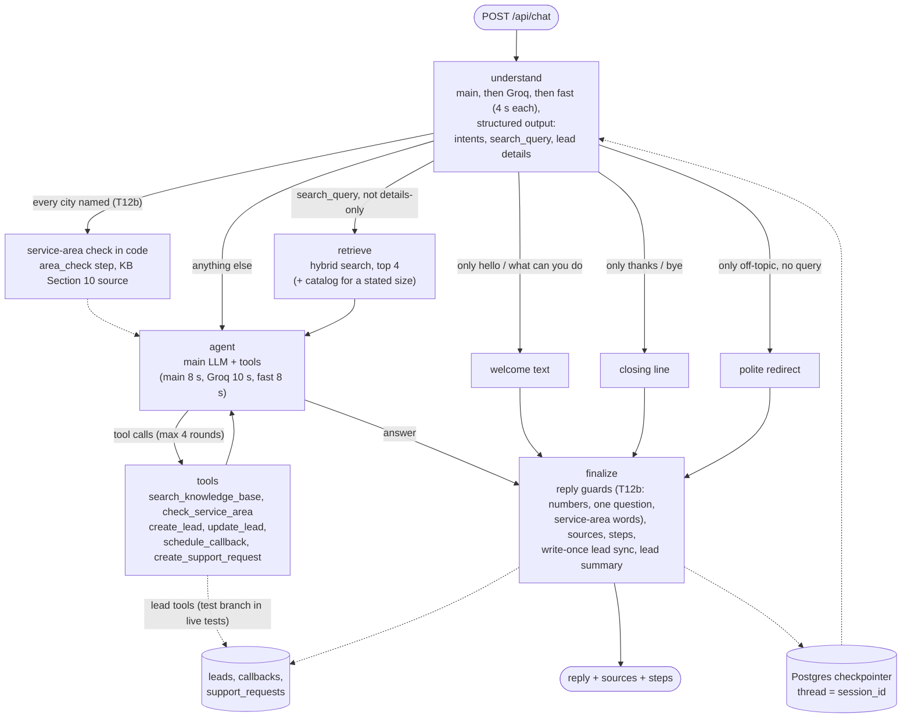
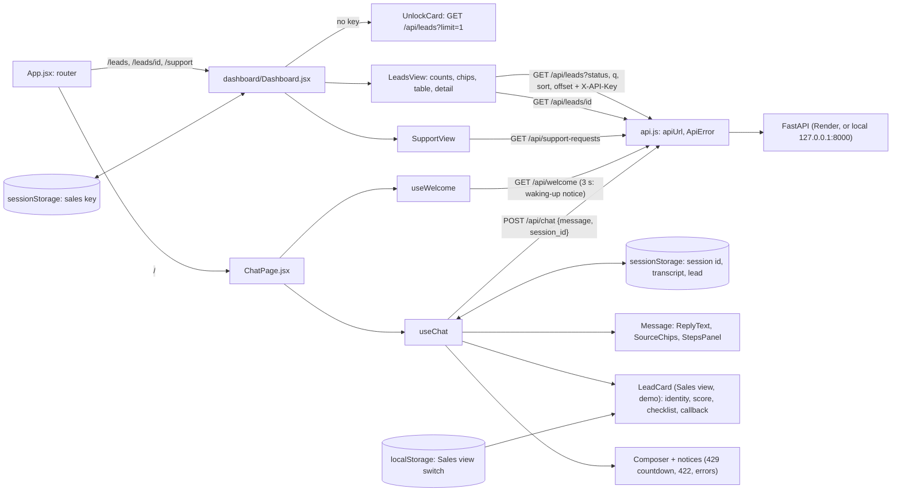

# ARCHITECTURE.md

Short map of how the code is built. Updated at the end of each task. See `docs/PLAN.md` for the full design.

## Backend modules (as of T12b)
| Module | Role |
|---|---|
| `app/main.py` | FastAPI app, startup hook (`init_db`), request-id + logging middleware (skips `QUIET_PATHS`: `/api/health/live`; adds `ip_source` for rate-limited requests, never the IP), error handlers (`ApiError`, 422 with one message per field, database down → 503), CORS (GET/POST; `Content-Type`, `X-API-Key`, `X-Request-ID`; exposes `Retry-After`), routers |
| `app/core/config.py` | `Settings` (pydantic-settings, reads `backend/.env`), `get_settings()` |
| `app/core/rate_limit.py` | `RateLimiter(limits)`: in-memory fixed windows per key, thread-safe; `hit()` counts or returns the seconds to wait (a refused request is not counted), `blocked()` only checks |
| `app/api/security.py` | `client_ip` (the `CLIENT_IP_HEADER` value if it is one valid IP, else the connection address; never `X-Forwarded-For`), `limit_key` (IPv6 per /64), `chat_rate_limit` (10/min + 100/day per IP → 429 + Retry-After), `require_sales_key` (`X-API-Key`, constant-time, fails closed, 10 wrong keys per 15 min per IP → 429), `ApiError` + `error_response` (the JSON error shape) |
| `app/api/sales.py` | Sales router (key required): `GET /api/leads`, `GET /api/leads/{id}`, `POST /api/leads`, `POST /api/callback` (T12a: 201 new, 200 when the lead's request gets the new time), `GET /api/support-requests`, all through `app/leads/service.py`; never returns `session_id`. T11: `GET /api/leads` also takes `q` (name or city) and returns `counts` (leads per status in the whole table); its items carry `customer_type`, `property_type` and `source_channel` |
| `app/core/logging.py` | JSON log formatter, `request_id_var` |
| `app/core/db.py` | `Base`, `get_engine()` (Neon, pre-ping), `check_db()`, `init_db(engine)` (pgvector + `create_all`) |
| `app/core/llm.py` | `embedder()` and `query_embedder()` (google-genai, one Content per text, batches of 20, LRU cache for queries; T12a: a query is one attempt cut off after 3 s, and the embedder is skipped after 2 failures in a row). `GeminiChat`: adds its `request_http` (10 s, its minimum, and no retry) to every Gemini request. T12a: `call_with_deadline` (8-worker pool), `failure_kind` (timeout, 429, 5xx), `SkipList`/`SKIPS` (a model is skipped for 60 s after a timeout or 429, 120 s after a 5xx; `failures_before_skip`: an understand timeout, 5xx or 429 at once, an answer or reason timeout on the 2nd in a row, the embedder on the 2nd of anything), `Candidate` and `model_chain` (one attempt each, skip, log, `LLMError` when all fail). `understand_llm(schema)`: main, Groq, fast, 4 s each. `chat_llm(model, tools=, schema=)` (`answer_candidates`): main 8 s, Groq 10 s, fast 8 s (Groq: `parallel_tool_calls=False`). `reason_llm()`: main only, 4 s. T12b, offline scripts only (eval, seed): `Embedder.embed_queries` (batches of 20, ingest's 30 s and 3 attempts, no skip list), `NoSkips`, `patient(chain)` (the whole chain retried after a timeout, 429 or 5xx, 5 s then 20 s apart), `offline_understand_llm(schema)` and `offline_reason_llm()` (30 s per call); the chat stays fail-fast. `main_llm()`, `tokens_of()`, `invoke_llm()`, `provider_of()`, `reply_text()` |
| `app/core/prompts.py` | `load_prompt(name)`: reads `prompts/<name>.md` (cached) |
| `app/agent/state.py` | `AgentState` (persisted `messages`, `lead`, T12a `ruled_out`; per-turn fields, T12a: `new_details`, `declines`, `lead_created_now`, `callback_now`; T12b: `area_checks`) and `turn_input()`, which resets the per-turn fields |
| `app/agent/understand.py` | `Understanding` schema (intents incl. T12a `asks_what_is_needed`, `search_query`, details generated from `LeadData`, T12b `cities`: every city named in the message), `load_kb_hints` (section titles + table summary chunks from `kb_chunks`), `understand()` (also returns the call's tokens) |
| `app/agent/tools.py` | `make_tools`: `search_knowledge_base`, `check_service_area` (content + KB chunk artifacts) and, with `LeadOps`, `create_lead`, `update_lead`, `schedule_callback` (T12a: a new time updates the lead's one request, `"updated": true`), `create_support_request` (no arguments; read the draft via `InjectedState`; no score in results); `tool_step` (T12b: a saved support request's step shows its id); T12b `service_area_data` (the city result, shared with the graph's own check) |
| `app/agent/graph.py` | `build_graph(AgentDeps)`: understand → retrieve → agent ⇄ tools → finalize, plus welcome / closing / redirect; `build_agent()`, `get_agent()` (FastAPI dependency). T12a: understand merges callback times and short answers and turns a time of day into a callback time; finalize runs the reply guards (`strip_unsourced_citations`, `remove_false_claims`, `fix_callback_claims`, `soften_promises`), each a "guard" step when it fires; steps carry the model and tokens. T12b: understand turns a KB question labelled `asks_what_is_needed` into a search (`own_details_question`) and searches with the message when a question came with no query; `check_named_cities` checks every city named before the model (an `area_check` step, the KB Section 10 summary as the first chunk, the results in the agent's message); retrieve adds the catalog summary for a stated size (`add_catalog_for_size`); finalize adds the number guard (`remove_unsupported_numbers`), `plain_service_area_words` and `keep_one_question`; a model failure after a tool wrote something replies with what was done (`tool_outcome_reply`) |
| `app/agent/leads.py` | `LeadOps` (leads database, reason model, `reason_now`), the lead progress block (`status_block`; T10b: says not to ask for details until `shows_interest`; T12a: after the save, the details that would still add points and one next line, with `next_detail` chosen in code), `confirmed_city`, T12a `short_answer_details`, `merge_callback_time`, `is_clock_time`, `ruled_out_details`, `remove_false_claims`, `fix_callback_claims`; T12b `own_details_question`, `keep_one_question` (the question for the next missing detail, else the last); `pending_changes` (write-once sync), `lead_summary` for the API (T10c: plus `card_fields`: name, city, property and customer type, and the names of the known fields, never their values) |
| `app/core/tracing.py` | `configure_tracing`: optional LangSmith; copies LANGSMITH_* settings into os.environ only when tracing is on and a key is set |
| `app/agent/memory.py` | `get_checkpointer()` (PostgresSaver over a psycopg pool), `setup_checkpointer()` (never fails the boot) |
| `app/agent/welcome.py` | Fixed texts: welcome (F0), starter questions, closing line, off-topic redirect; T12a: the honest lines the guards use (still needed, ready to pass on, callback logged / updated / exists, ask for a call time); T12b: `NUMBERS_CONFIRM_TEXT` (the team confirms exact numbers), `SAVED_FALLBACK_TEXT`, `SUPPORT_SAVED_FALLBACK_TEXT` |
| `app/api/welcome.py` | `GET /api/welcome` |
| `app/api/health.py` | `GET /api/health` (status, db, kb_chunks); `GET /api/health/live` (`{"status":"ok"}`, no DB, Render's health check) |
| `app/api/chat.py` | `POST /api/chat`: rate limited (`chat_rate_limit`); `session_id` must be a UUID v4 (the server issues one when none is sent); validates the message, runs the agent with `thread_id` = `session_id`, returns reply, sources, steps, `lead` (summary; status and score only with `CHAT_SHOW_LEAD_SCORE`) and degraded. One turn per session (striped locks, 60 s timeout); a pending lead reason is written after the reply (background task). DB errors → 503 (T12b: "We can't reach our database right now…", also for a failed lead write); anything else → 200 degraded |
| `app/rag/answer.py` | Helpers the agent reuses: `format_context` (`[KB Section N: Title]` labels), `rag_message`, `cited_sections`, `pick_sources` (one per cited section; T12a: none when nothing is cited), `normalize_citations`, `strip_tool_citations` (removes a tool cited like a source), T12a `strip_unsourced_citations` (tags only on facts from this turn's chunks; never on a question, a thank-you or a claim), `is_claim`, `split_sentences`, `soften_promises` ("will follow up" → "can"), T12b `plain_service_area_words` ("reference locations" → "service areas", outside tags), `rag_message` with the city checks, `tidy_citations` (each KB section cited once, with its full label), `retrieve_step`, `LLM_DOWN_REPLY` |
| `app/rag/numbers.py` | T12b number guard: `number_mentions` (digits with ₹/k/lakh and units, number words and vague amounts with a unit), `known_numbers`, `is_supported`, `remove_unsupported_numbers` (a sentence stating a number no allowed text gives is removed; for a duration, amount or percentage the fixed "team confirms" line takes its place once). Allowed: this turn's chunks and tool results, every customer message and earlier reply, validation messages |
| `app/rag/pdf_parser.py` | `parse_kb(path)`: KB PDF to numbered sections with text lines and tables (pdfplumber; cover, header and footer removed) |
| `app/rag/chunker.py` | `Chunk`, `chunk_sections()`: one chunk per table row (KB Sections 8-12) plus one `table_summary` chunk listing every row (8, 10), one per FAQ item (15), prose split at ~1,200 chars, Sections 16-19 tagged `policy`; `embed_text()` = `title: ... \| text: ...` |
| `app/rag/models.py` | `KbChunk` (`kb_chunks`: vector + generated tsvector with GIN index) and `ServiceArea` (`service_areas`, unique on city + region) |
| `app/rag/ingest.py` | `python -m app.rag.ingest`: parse, chunk, embed all first, then replace all rows in ONE transaction; `--dry-run` prints chunks and touches no DB or key |
| `app/rag/retriever.py` | `search(query, k, mode)`: keyword (stemmed words OR'd, words in more than 30% of chunks dropped, `ts_rank_cd`) + vector (cosine), RRF fusion (k = 60, keyword weight 0.5), relevance gate (similarity only when a vector search ran), keyword fallback with `degraded`; policy chunks never returned |
| `app/leads/schemas.py` | `LeadData` (the lead contract: every field optional, null = unknown, units in names, per-field `description` for T8's structured output, `from_raw` keeps valid values and reports invalid ones), `LeadView` and the result models |
| `app/leads/validators.py` | Pure validators: Indian mobile → `+91XXXXXXXXXX`, email syntax (email-validator, no network), ₹ amounts (`₹4,000`, `4k`, `1.2 lakh`; `AMOUNT_MULTIPLIERS` shared with the number guard), kW, kWh, names, text; plain error messages (T12b: `PHONE_INVALID`) |
| `app/leads/scoring.py` | `score_lead` (rubric, caps at WARM and 74, recorded only when they lower the score; breakdown JSON), `status_for`, `recommended_action` (T12a: a callback time replaces the status's timing), `missing_details` (most useful first), T12a `next_status_gap`, T12b `status_gaps` (with each gap's rule, so the template never names a factor twice), `missing_for_creation` |
| `app/leads/reason.py` | `write_reason`: one sentence from `reason_llm` (T12a: the main model; breakdown and next-status gap only, no personal details or money), template fallback; `gap_phrase` ("not HOT yet: no timeline"), `problem_with`. T12b: the LLM writes only the first part and code adds the ending once; a reply that copies the prompt, names another status or repeats the ending gets the template |
| `app/leads/models.py` | `Lead` (`leads`), `Callback` (`callbacks`, status `requested`), `SupportRequest` (`support_requests`) |
| `app/leads/service.py` | `create_lead` (refuses until the minimum fields, one lead per session; channel `web`, `whatsapp` or `demo`), `update_lead` (merge, re-locate, re-score), `get_lead`, `list_leads` (status, `search` in the name, city or the customer's city words with LIKE wildcards escaped, sort, paging), `lead_counts` (one GROUP BY), `schedule_callback` (T12a: one requested callback per lead, a new time updates it), `create_support_request`, `list_support_requests`; logs ids, status and score only |
| `app/services/service_areas.py` | `ServiceAreas.lookup(city, state)`: alias map + rapidfuzz (score 85), then (T12b) one swapped pair of letters (`one_swap_apart`: "Dehli" → Delhi; never any other one-letter change, so Raipur stays unverified); loads from the `service_areas` table (`get_service_areas()`, cached) |
| `scripts/list_models.py` | Lists Gemini chat and embedding models for the key |
| `scripts/search_kb.py` | Prints the mode, `no_context` and the top chunks with scores and ranks |
| `scripts/serve_test_branch.py` | Dev only: runs the API on 127.0.0.1:8000 with the chat agent's lead writes and the sales API (`leads_engine`) on `TEST_DATABASE_URL`; KB and service areas read from main; chat memory in the process (`InMemorySaver`). `engine_for_test_branch` refuses an empty or same-as-main URL. T12a: `--slow-gemini` (`force_gemini_timeouts`, `HangingGemini`) makes every Gemini chat call hang 10 s for the slow-Google drill; a flag of this dev script only, not in the Docker image. T12b: `--port` |
| `scripts/seed_demo_leads.py` | T11: 8 demo leads (source_channel `demo`) through `service.create_lead`, 2 callbacks and 1 support request, clearly fake contacts; skips what is already there; test branch by default (`engine_for_test_branch`), `--main` only after "main" is typed. T12a: `--reset` (test branch only) empties the lead tables first; the summary prints each reason. T12b: reasons on `offline_reason_llm` |
| `scripts/eval_retrieval.py` | Embeds the 24 KB and 8 off-topic questions once, runs `search()` in all three modes (k = 10), prints hit@1, hit@3, MRR, the misses and the gate results, and writes `docs/EVAL.md` (its "Tuning notes" section is hand-written and kept). `--rewrite` adds the understand step's rewritten query (`rewrite` and `fused` modes) and the small-to-big report. T12b: also the 8 held-out questions (`data/eval/holdout_eval.jsonl`) in their own section, "best section" and "any listed section" side by side; embeds and rewrites on the offline path |
| `scripts/live_scenarios.py` | T12b, dev only: the held-out chat and the assignment's edge cases against a running `serve_test_branch` (`--group holdout`, `edge` or `slow`), one session per scenario, PASS/FAIL per check, a markdown table for `docs/EVAL.md`; the number check reads the KB from main (read-only) |

## Request flow

## Chat v0 (T5)

## Ingestion (T3)

## Retrieval (T3, tuned in T4)

## Retrieval eval (T4)

## Deployment (T6)
Files at the repo root: `Dockerfile` (python:3.12-slim, only the app package and `prompts/`, non-root user, one uvicorn worker on `$PORT`), `.dockerignore`, `render.yaml` (one free web service, region Singapore, next to Neon). Steps and limits: `docs/DEPLOY.md`.

## Leads layer (T7)
Called by T8's tools and T9's sales API (`app/api/sales.py`). Rules in plain words: `docs/SCORING.md`.

## Agent graph (T8a)
One customer message; state checkpointed in Postgres per `session_id`. Details: PLAN.md part 3.1.

## Frontend: chat page and sales dashboard (T10, T10c, T11, `frontend/`)
React 19 + Vite 8, plain JavaScript and CSS, lucide-react icons, Plus Jakarta Sans (self-hosted), no router package. Behaviour and design: PLAN.md parts 3.14 (chat) and 3.15 (dashboard); credits: `docs/CREDITS.md`.

| Module | Role |
|---|---|
| `src/main.jsx`, `src/App.jsx`, `src/router.jsx` | The entry (`styles.css` first, so a page's own CSS can adjust it); the router: `/` chat, `/leads`, `/leads/<id>`, `/support`, else "Page not found", and the tab's title; `usePath()` (`useSyncExternalStore`), `navigate()` (History API), `<Link>` (a real link; plain left clicks stay in the app) |
| `src/api.js` | `apiUrl(path)` (VITE_API_URL, trailing slashes removed, default `http://127.0.0.1:8000`), `getWelcome()`, `postChat({message, sessionId})`, `ApiError` (`rate_limit` / `invalid` / `unauthorized` / `not_found` / `server` / `network`, plus the API's `detail`), `errorFrom` (429 → `detail` + `retry_after` or the `Retry-After` header; 422 → first field message; else a generic message); T11: `getLeads`, `getLead`, `getSupportRequests` (the sales key in `X-API-Key`, never in the URL; the answer's shape checked); 90 s timeout |
| `src/storage.js` | `loadChat` / `saveChat` / `clearChat`: session id, transcript and lead in sessionStorage; `loadSalesView` / `saveSalesView`: the Sales view switch in localStorage (on by default); T11: `loadSalesKey` / `saveSalesKey` / `clearSalesKey`: the sales key in sessionStorage only; never throws |
| `src/useChat.js` | The conversation hook: messages, lead, session id, draft, `pending` / `slow` (8 s), `notice`, `waitLeft` (429 countdown), `send(text)` (one at a time; on failure the text goes back into the draft; each new message gets an `at` time), `newChat()` |
| `src/useWelcome.js` | `GET /api/welcome` once; `slow` after 3 s (the waking-up notice), `retry()` after an error |
| `src/ChatPage.jsx`, `src/useWideScreen.js` | The chat page (was `App.jsx` until T11): the frame grid (header, sidebar, chat card, sales card; no sidebar below 1100 px; phone strip below 900 px), `useSalesView`, welcome + starters, typing indicator, screen-reader announcer; the 900 px media query as a hook |
| `src/components/Header.jsx`, `Sidebar.jsx`, `Logo.jsx` | Brand, Sales view switch (`role="switch"`), New chat; `Sidebar` (`current`, `staff`, `brand`) and `SectionNav`: Chat, and Leads and Support requests only with `staff` (the chat page passes the Sales view switch), the current one a marker, the others links; the rooftop photo (CSS background); the sun-and-horizon mark (`Logo`, and `SunMark` for the assistant avatar) |
| `src/components/ReplyText.jsx` | Reply text as React text nodes: paragraphs, lists (`<ol start>`), "# " headings, bold and italics with stray asterisks dropped (underscores kept), `[KB Section N: Title]` → a quiet "KB N" tag |
| `src/components/SourceChips.jsx`, `StepsPanel.jsx`, `Message.jsx` | Source pills (`
`: book icon, "KB 8 · title", snippet on open); "How I answered · N steps · X s" (`
`, the bubble's footer: label, detail, time in seconds; T12a: a reply guard that fired shows as "Safety check on the reply"); one message with its avatar and `<time>` |
| `src/components/LeadCard.jsx` | "Sales view (demo)": name, "City · type", status badge and score (only when sent), saved or not, "Details collected" (`checklist(lead)` from `known_fields`), still needed / would add points, callback; designed empty state. Exports `StatusBadge` (`compact`: no icon) and `DETAILS` for the dashboard |
| `src/components/Composer.jsx` | Textarea (Enter sends, Shift+Enter new line, 1,000 characters), Send / "Wait N s" |
| `src/dashboard/Dashboard.jsx`, `UnlockCard.jsx` | T11: the staff shell (wide sidebar, header with search, Refresh, Lock; tabs below 1280 px) and the unlock gate; Lock and any 401 forget the key; `unlockMessage` (401, 429 with the wait, 503 in the API's words) |
| `src/dashboard/LeadsView.jsx`, `LeadTable.jsx`, `LeadDetail.jsx`, `SupportView.jsx` | Count cards (API `counts`), status chips, the table (desktop) or cards (phone), Load more, the selected lead (T12a order: name, badge and score; full next action, callback, contact; score breakdown and caps, reason, details collected), support requests; loading, empty and error states |
| `src/dashboard/useSalesData.js`, `format.js`, `dashboard.css` | Paged lists (stale answers dropped, 401 → unlock), the lead detail, `useSlow` (3 s waking notice), `useDebounced`; pure text helpers (one-line requirement, first sentence, "2 h ago", phone format); the dashboard's styles on the shared tokens |
| `src/*.test.js(x)`, `src/contrast.test.js` | Vitest + Testing Library, `fetch` stubbed (`src/test-utils.js`: chat and sales routes, lead fixtures); the contrast of every colour pair in light and dark, read from `styles.css` |

