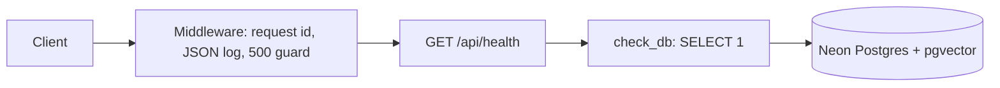
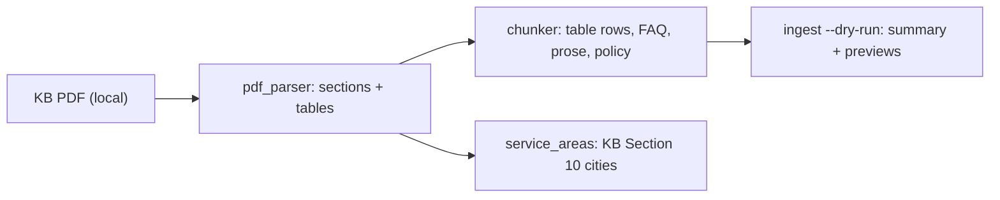

# ARCHITECTURE.md

Short map of how the code is built. Updated at the end of each task. See `docs/PLAN.md` for the full design.

## Backend modules (as of T2)
| Module | Role |
|---|---|
| `app/main.py` | FastAPI app, startup hook (`init_db`), request-id + logging middleware, CORS, routers |
| `app/core/config.py` | `Settings` (pydantic-settings, reads `backend/.env`), `get_settings()` |
| `app/core/logging.py` | JSON log formatter, `request_id_var` |
| `app/core/db.py` | `get_engine()` (Neon, pre-ping), `check_db()`, `init_db()` (pgvector) |
| `app/api/health.py` | `GET /api/health` |
| `app/rag/pdf_parser.py` | `parse_kb(path)`: KB PDF to numbered sections with text lines and tables (pdfplumber; cover, header and footer removed) |
| `app/rag/chunker.py` | `Chunk`, `chunk_sections()`: one chunk per table row (KB Sections 8-12) or FAQ item (15), prose split at ~1,200 chars, Sections 16-19 tagged `policy`; `embed_text()` adds the header |
| `app/rag/ingest.py` | `python -m app.rag.ingest --dry-run`: prints per-section counts and chunk previews (DB writes come in T3) |
| `app/services/service_areas.py` | `ServiceAreas.lookup(city, state)`: city list from KB Section 10, alias map, rapidfuzz (score 85) |
| `scripts/list_models.py` | Lists Gemini chat and embedding models for the key |

## Request flow

## Ingestion (dry run, T2)

