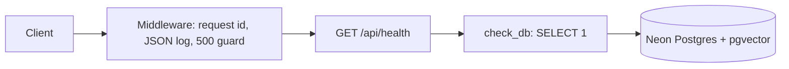

# ARCHITECTURE.md

Short map of how the code is built. Updated at the end of each task. See `docs/PLAN.md` for the full design.

## Backend modules (as of T1)
| Module | Role |
|---|---|
| `app/main.py` | FastAPI app, startup hook (`init_db`), request-id + logging middleware, CORS, routers |
| `app/core/config.py` | `Settings` (pydantic-settings, reads `backend/.env`), `get_settings()` |
| `app/core/logging.py` | JSON log formatter, `request_id_var` |
| `app/core/db.py` | `get_engine()` (Neon, pre-ping), `check_db()`, `init_db()` (pgvector) |
| `app/api/health.py` | `GET /api/health` |
| `scripts/list_models.py` | Lists Gemini chat and embedding models for the key |

## Request flow

