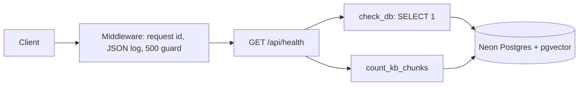
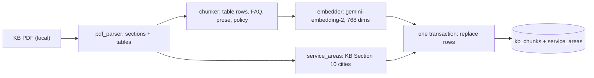
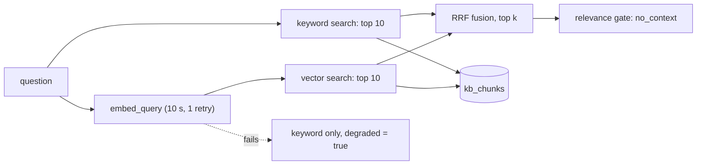

# ARCHITECTURE.md

Short map of how the code is built. Updated at the end of each task. See `docs/PLAN.md` for the full design.

## Backend modules (as of T3)
| Module | Role |
|---|---|
| `app/main.py` | FastAPI app, startup hook (`init_db`), request-id + logging middleware, CORS, routers |
| `app/core/config.py` | `Settings` (pydantic-settings, reads `backend/.env`), `get_settings()` |
| `app/core/logging.py` | JSON log formatter, `request_id_var` |
| `app/core/db.py` | `Base`, `get_engine()` (Neon, pre-ping), `check_db()`, `init_db(engine)` (pgvector + `create_all`) |
| `app/core/llm.py` | `embedder()`: google-genai, one Content per text, batches of 20, vector count and size checks, document vs query timeouts, LRU cache for queries |
| `app/api/health.py` | `GET /api/health` (status, db, kb_chunks) |
| `app/rag/pdf_parser.py` | `parse_kb(path)`: KB PDF to numbered sections with text lines and tables (pdfplumber; cover, header and footer removed) |
| `app/rag/chunker.py` | `Chunk`, `chunk_sections()`: one chunk per table row (KB Sections 8-12) or FAQ item (15), prose split at ~1,200 chars, Sections 16-19 tagged `policy`; `embed_text()` = `title: ... \| text: ...` |
| `app/rag/models.py` | `KbChunk` (`kb_chunks`: vector + generated tsvector with GIN index) and `ServiceArea` (`service_areas`, unique on city + region) |
| `app/rag/ingest.py` | `python -m app.rag.ingest`: parse, chunk, embed all first, then replace all rows in ONE transaction; `--dry-run` prints chunks and touches no DB or key |
| `app/rag/retriever.py` | `search(query, k, mode)`: keyword (OR'd `plainto_tsquery`, `ts_rank_cd`) + vector (cosine), RRF fusion (k = 60), relevance gate, keyword fallback with `degraded`; policy chunks never returned |
| `app/services/service_areas.py` | `ServiceAreas.lookup(city, state)`: alias map + rapidfuzz (score 85); loads from the `service_areas` table (`get_service_areas()`, cached) |
| `scripts/list_models.py` | Lists Gemini chat and embedding models for the key |
| `scripts/search_kb.py` | Prints the mode, `no_context` and the top chunks with scores and ranks |

## Request flow

## Ingestion (T3)

## Retrieval (T3)

